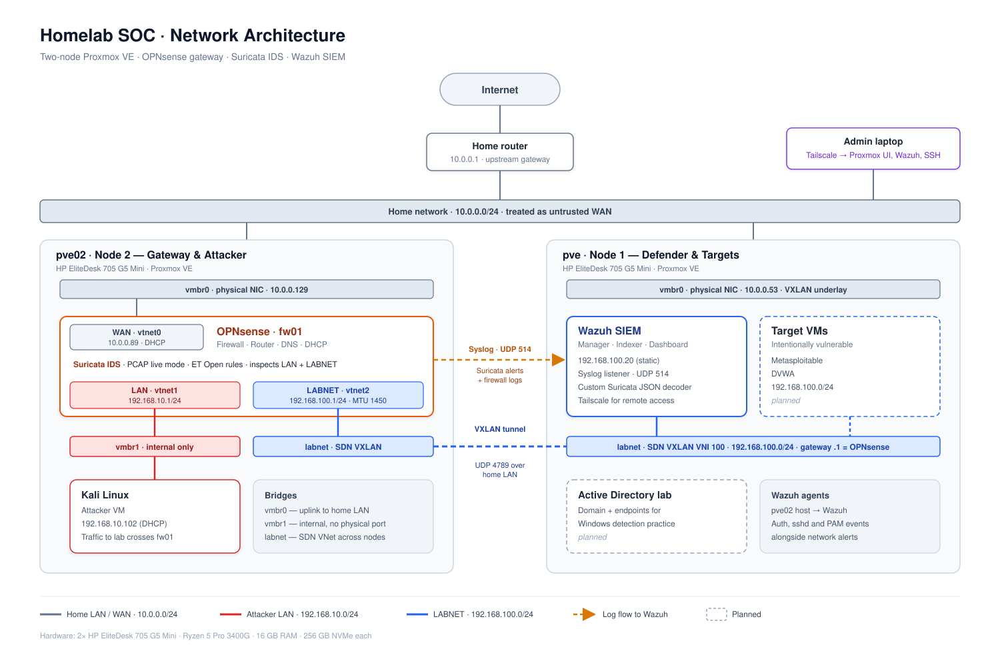

# Network Design

## Overview

The lab runs on two Proxmox VE nodes. **OPNsense (`fw01`) is the gateway for every lab network**, so any traffic between the attacker network and the lab network has to pass through it. That's what lets Suricata, running on OPNsense, see attacks as they happen. Suricata alerts and firewall logs are forwarded to Wazuh over syslog, where they become searchable alerts.

The home network upstream is treated as untrusted WAN. Nothing on it can reach the lab networks directly.

---

## Address plan

| Network | Subnet | Gateway | Proxmox bridge | Purpose |
|---|---|---|---|---|
| Home / WAN | `10.0.0.0/24` | `10.0.0.1` (home router) | `vmbr0` | Upstream internet, node management |
| LAN (attacker) | `192.168.10.0/24` | `192.168.10.1` (fw01) | `vmbr1` | Kali and other attacker tools |
| LABNET (lab) | `192.168.100.0/24` | `192.168.100.1` (fw01) | `labnet` (SDN VXLAN) | Wazuh and target VMs |

- **LAN DHCP:** `192.168.10.100` to `192.168.10.200`, served by OPNsense
- **DNS:** Unbound on fw01; local domain `home.arpa`
- **LABNET hosts** use static addressing, with fw01 as gateway and DNS

## Host inventory

| Host | Role | Node | Network | IP | Notes |
|---|---|---|---|---|---|
| `fw01` | OPNsense firewall / router / IDS | pve02 | WAN | `10.0.0.89` | DHCP from home router (`vtnet0`) |
| | | | LAN | `192.168.10.1` | `vtnet1` |
| | | | LABNET | `192.168.100.1` | `vtnet2`, MTU 1450 |
| `kali` | Attacker VM | pve02 | LAN | `192.168.10.102` | DHCP |
| `wazuh-server` | Wazuh SIEM (manager, indexer, dashboard) | pve | LABNET | `192.168.100.20` | Static; Tailscale for remote access |
| Metasploitable | Vulnerable target | pve | LABNET | TBD | Planned |
| DVWA | Vulnerable web app | pve | LABNET | TBD | Planned |

**Proxmox hosts**

| Node | Hostname | Management IP | Hardware |
|---|---|---|---|
| Node 1 | `pve` | `10.0.0.53` | HP EliteDesk 705 G5 Mini · Ryzen 5 Pro 3400G · 16 GB · 256 GB NVMe |
| Node 2 | `pve02` | `10.0.0.129` | HP EliteDesk 705 G5 Mini · Ryzen 5 Pro 3400G · 16 GB · 256 GB NVMe |

---

## Proxmox networking

Each node has a single physical NIC, so segmentation is done in software.

| Bridge | Type | Physical port | Used for |
|---|---|---|---|
| `vmbr0` | Linux bridge | Yes | Node management, fw01 WAN, VXLAN underlay |
| `vmbr1` | Linux bridge | **No** (internal only) | Attacker LAN on pve02 |
| `labnet` | SDN VNet (VXLAN) | Rides over `vmbr0` | Lab network spanning both nodes |

**labnet SDN settings**

- Zone type: VXLAN
- VNI: `100`
- Peers: `10.0.0.53, 10.0.0.129`
- MTU: `1450` (VXLAN adds 50 bytes of overhead, so anything attached to labnet, including fw01's `vtnet2`, must use 1450)
- Transport: UDP `4789` between the nodes over the home LAN
- No SDN gateway or SNAT. fw01 is the only gateway for this network.

Because Wazuh lives on pve and fw01 lives on pve02, all LABNET traffic to and from the gateway crosses the VXLAN tunnel.

---

## Firewall policy (fw01)

| Interface | Inbound policy | Notes |
|---|---|---|
| WAN | Default deny | Private and bogon networks blocked |
| LAN | Allow LAN net → any | OPNsense default |
| LABNET | **Default deny**, with two exceptions (below) | Vulnerable targets can't reach the internet |

**LABNET rules (top to bottom, first match wins):**

| # | Action | Source | Destination | Purpose |
|---|---|---|---|---|
| 1 | Pass | `192.168.100.20` (Wazuh) | any | Wazuh needs updates, threat feeds, and Tailscale |
| 2 | Pass | LABNET net | LAN net | Targets can reach Kali (e.g., reverse shells during exercises) |
| 3 | Block (logged) | LABNET net | any | Everything else, including the targets' internet access |

Traffic Kali starts toward the targets still works, because the firewall tracks connection state and lets replies back through. Rule 3 is logged, so any lab host trying to reach out shows up as a firewall block in Wazuh.

- **Outbound NAT:** automatic. LAN and LABNET are both translated to the WAN address.
- **Anti-spoofing:** LABNET addresses are dropped if they show up on any interface other than `vtnet2`.
- **Management:** the OPNsense web UI is reachable only from the inside networks (for example, from Kali), not from WAN.

## Intrusion detection (Suricata on fw01)

| Setting | Value |
|---|---|
| Mode | IDS (PCAP live mode), detect only |
| Interfaces | LAN, LABNET |
| HOME_NET | `192.168.10.0/24, 192.168.100.0/24` |
| Rules | ET Open (all categories), updated daily |
| Pattern matcher | Default |
| Output | eve JSON to syslog, forwarded to Wazuh |

Suricata watches the inside interfaces rather than WAN, so alerts show real internal IPs instead of the NAT address.

---

## Traffic flows

**1. Attack path (inspected)**
Kali (`192.168.10.102`) → `vmbr1` → fw01 LAN → Suricata inspects → fw01 LABNET → VXLAN → target VM on pve.

**2. Log path**
fw01 → syslog over UDP `514` → Wazuh (`192.168.100.20`).
- Applications forwarded: `suricata` (IDS alerts) and `filter` (firewall log)
- Wazuh accepts syslog only from `192.168.100.1`
- A custom decoder in `local_decoder.xml` parses Suricata's JSON so Wazuh's built-in Suricata rules (86600/86601) match
- Firewall logs decode with Wazuh's built-in pfSense rules

**3. Remote administration**
Admin laptop → Tailscale → Proxmox web UI, Wazuh dashboard, and SSH. No ports are opened on the home router.

---

## Design decisions

- **One gateway for everything.** Making fw01 the gateway for both LAN and LABNET forces attacker-to-target traffic through Suricata. Before this, the Proxmox node was labnet's gateway, and attack traffic never crossed the IDS.
- **Separate subnets for attacker and lab.** A router can't route between two networks with the same address range, and keeping Kali off the lab subnet means its traffic has to be routed (and inspected) to reach a target.
- **VXLAN instead of VLANs (for now).** Each node has one NIC, and I didn't have a managed switch in the path yet. An SDN VXLAN VNet lets the lab network span both nodes without any switch configuration.
- **IDS, not IPS.** Detect-only mode lets attacks complete so they can be investigated end to end. Inline blocking on VirtIO NICs can also be unreliable.

## Known limitations

- **Traffic within LABNET isn't inspected.** VM-to-VM traffic on the same subnet (for example, Metasploitable talking to Wazuh) is switched by the bridge and never crosses fw01.
- **Encrypted traffic:** Suricata sees TLS metadata (SNI, certificates), not contents.
- **Targets can still reach Kali** (rule 2), which exercises need. A compromised target could pivot toward the attacker LAN, which is acceptable in a lab but worth noting.
- **Node IPs come from home DHCP.** If a node's address changes, the VXLAN peer list breaks. Both nodes need DHCP reservations or static IPs.
- **Noise:** Tailscale's STUN traffic triggers ET INFO alerts and still needs tuning.

## Planned changes

- [x] Replace the LABNET allow-all rule with a default-deny policy
- [ ] Move Metasploitable (VM 100) onto LABNET at `192.168.100.30`
- [ ] Deploy DVWA (Docker on VM 102) at `192.168.100.31`
- [ ] Static IPs or DHCP reservations for both Proxmox nodes
- [ ] Tune out STUN alerts in Wazuh
- [ ] Separate segment for targets so attacks on them are inspected even from inside the lab
- [ ] VLAN trunking through a managed switch
- [ ] Active Directory lab segment
